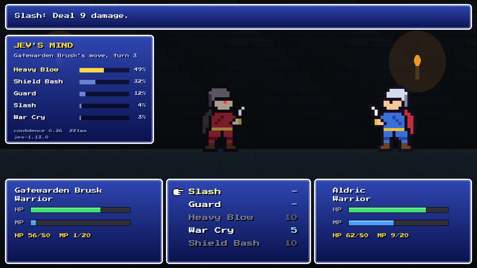
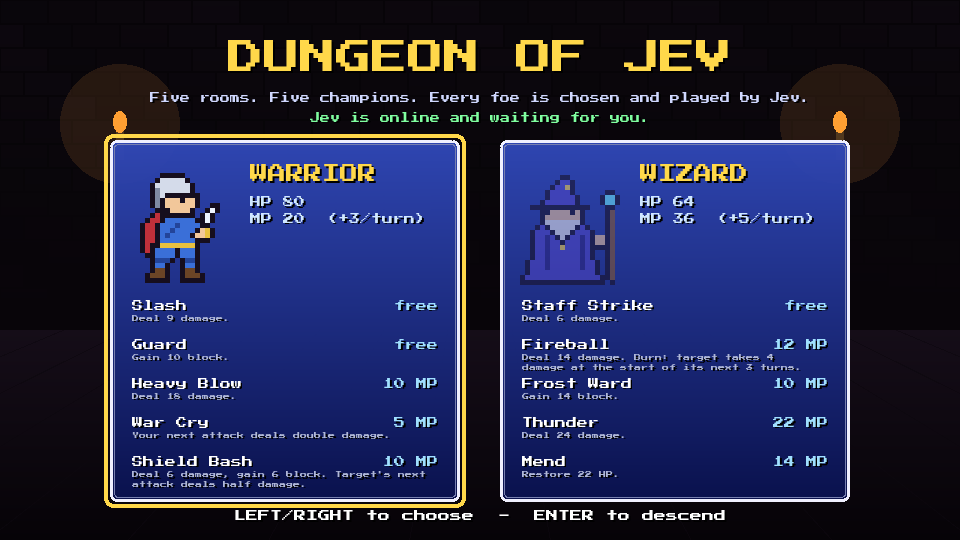
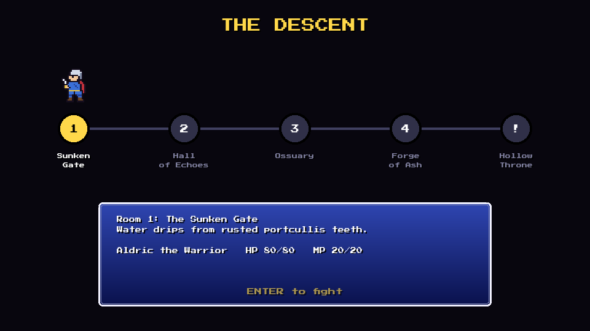
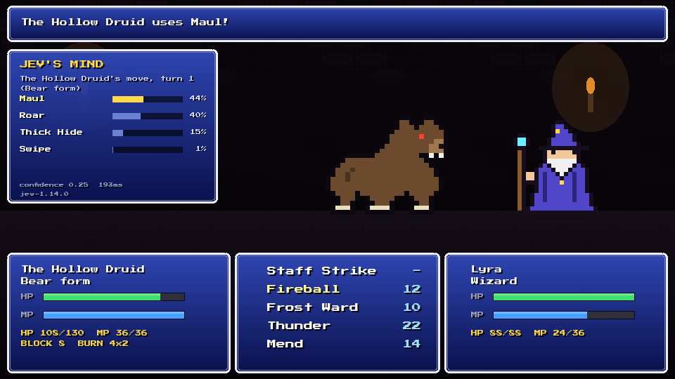

# Dungeon of Jev

**An example and exploration of what [Jev](https://docs.typesafe.ai) can do.** Jev is TypeSafe's
"System One" model: it doesn't generate text. It returns typed, calibrated judgments, such as
picking one option from a set or giving the probability of a yes. This project puts Jev in charge of
every enemy in a small turn-based dungeon crawler, to see how far that kind of model goes as a game AI.

**Play it: [doj.blocbrain.xyz](https://doj.blocbrain.xyz)**



## The game

- A browser game built with [Phaser 4](https://phaser.io). Battles use a Final Fantasy-style
  layout and keyboard controls, and each fight is a duel in the spirit of Slay the Spire.
- Five rooms. The first four each hold a champion; between rooms you rest, heal and get a little stronger.
- Two pre-set characters, a **Warrior** and a **Wizard**. The champions use **the same two classes, with
  the same abilities and rules**. Only the player behind them changes.
- The fifth room holds the final boss, **the Hollow Druid**, a shapeshifter you can't play. It has one
  big HP pool and three forms: **Druid** (Moonfire, Entangle, Rejuvenate), **Bear** (Thick Hide, Roar,
  Maul) and **Wolf** (Rend bleeds, Frenzy hits twice, Pounce). Jev decides when it shifts.
- Chiptune sound effects and music, synthesised in code with Web Audio. Press **M** to mute.
- Controls: arrow keys or W/S to move, Enter, Z or Space to confirm. The mouse works too.
- To practise the boss, open the game with `#boss` (for example `doj.blocbrain.xyz/#boss`). You start at
  the final room with a fully grown hero.

<p>
  
  
</p>

## Where Jev comes in

Jev makes three kinds of decisions, each as a single
[Choice](https://docs.typesafe.ai/primitives/choice) question:

1. **Which champion to send** (Warrior or Wizard), given your class, HP and the moves you lean on.
2. **Which form the boss opens the final fight in.**
3. **Which move to make** on every enemy turn. For the boss, "Shift to Bear" or "Shift to Wolf" sit
   alongside its attacks. A shift is a free action, so after shifting Jev decides again, in the new
   form. The boss can shift at most every other turn.



The **Jev's Mind** panel shows each decision as it happens: Jev's probability for every option,
its confidence, its latency (about 200 ms) and the model version.

### Code does the math, Jev makes the call

TypeSafe's guidance is to keep arithmetic in code and give the model narrow judgments. So the
server works out exactly what each available move would do right now and writes it into that
option's description. Jev never adds anything up. It weighs outcomes. Here is a real request
from turn 4 (the enemy Warrior is badly wounded and you are a Wizard):

```jsonc
{
  "model": "jev-1.14.0",
  "state": {
    "situation": "Turn 4 of a one-on-one turn-based duel. You control `enemy`. ...",
    "enemy":  { "class": "Warrior", "hp": "31/80", "condition": "badly wounded", "mp": "12/20", ... },
    "player": { "class": "Wizard",  "hp": "26/64", "condition": "wounded",       "mp": "30/36", ... },
    "danger": {
      "player_strongest_next_attack": "Thunder for 24 damage after the enemy's current block",
      "player_can_defeat_enemy_next_turn": "no"
    },
    "player_recent_moves": ["Fireball", "Thunder", "Staff Strike"]
  },
  "questions": {
    "pick": {
      "type": "choice",
      "instructions": "Which move should `enemy` use this turn to give `enemy` the best chance of defeating `player` before `player` defeats `enemy`?",
      "criteria": {
        "war_cry":     "War Cry (costs 5 MP, enemy MP 12 -> 7): Your next attack deals double damage. Next turn the enemy's best attack would deal 36 damage before block.",
        "guard":       "Guard (costs 0 MP, ...): Gain 10 block. The player's strongest next attack would deal 14 damage to the enemy instead of 24.",
        "heavy_blow":  "Heavy Blow (costs 10 MP, ...): Deal 18 damage. Right now it deals 18 damage: player HP 26 -> 8.",
        "slash":       "Slash (costs 0 MP, ...): Deal 9 damage. Right now it deals 9 damage: player HP 26 -> 17.",
        "shield_bash": "Shield Bash (costs 10 MP, ...): ... The player's strongest next attack would deal 6 damage to the enemy instead of 24."
      }
    }
  }
}
```

Jev's answer (about 900 input tokens, a fraction of a cent):

```json
{ "choice": "heavy_blow", "confidence": 0.21,
  "probabilities": { "heavy_blow": 0.37, "war_cry": 0.31, "shield_bash": 0.18, "guard": 0.13, "slash": 0.01 } }
```

It's a close call between hitting hard now and setting up a doubled hit next turn, and the
distribution shows that.

### What we learned building it

- **Give outcomes, not formulas.** "Player HP 26 -> 8" and "THIS DEFEATS THE PLAYER" in the options
  work far better than asking the model to combine stats. With them, Jev reliably takes guaranteed
  kills, defends when it's about to die, and follows War Cry with Heavy Blow (`scripts/eval-jev.ts`).
- **Shuffle the options.** jev-1.13 can lean toward the first option, so the order is randomised
  on every call. The eval checks that answers stay the same across orders.
- **Use the distribution, not just the top pick, when it's a matter of taste.** For champion class,
  Jev rates the matchup about 50/50. Always taking the top pick fielded the same class every time,
  so the class is drawn from Jev's probabilities. Moves are strategic, so they take the top pick.
- **The AI exposes balance bugs.** Jev's first full game was a stalemate: it found that Frost
  Ward could be repeated almost for free, and used it 16 times. A good opponent turns your design
  mistakes into strategies. `scripts/balance-sim.ts` now checks the numbers offline.
- **Design the rules so the AI's options are real.** In its first version, shifting cost the boss its
  whole turn. Jev shifted often anyway, because the entry bonuses looked good, and kept losing tempo.
  Making the shift a free action turned shapeshifting into a real tactic. Jev now moves between Bear
  and Wolf as the fight changes, and it shifts to Bear when it's about to die (about 0.9 confidence).
- **Jev is fast enough for real-time play.** About 200 ms per decision, so the enemy's "thinking"
  pause is mostly for drama.

## Run it

Requires [Bun](https://bun.sh) 1.3+ and a TypeSafe API key.

```bash
bun install
cp .env.example .env        # set TYPESAFE_API_KEY
bun run dev                 # http://127.0.0.1:3210
```

Without a key, the game still runs. Enemies then use a simple greedy AI, and the panel labels it
as such.

| Command | What it does |
| --- | --- |
| `bun run dev` | Dev server with hot reload |
| `bun test` | Combat rules tests |
| `bun run typecheck` | TypeScript check |
| `bun scripts/balance-sim.ts` | Offline balance simulation (no API calls) |
| `bun scripts/eval-jev.ts` | Jev on clear-cut scenarios, each repeated with shuffled options |
| `bun scripts/jev-sim.ts 3` | Full dungeon runs, a scripted player against real Jev |

## How it's built

```
server.ts               Bun server: serves the game and proxies Jev (the API key stays server-side)
src/shared/rules.ts     Classes, moves and deterministic combat, shared by browser and server
src/server/jev.ts       Builds the Jev questions and computes each option's outcome
src/client/             Phaser scenes (title, map, battle, end), FF-style UI, pixel art drawn in code
src/client/sfx.ts       Sound effects and chiptune music synthesised with Web Audio
scripts/                Balance simulator and Jev evaluations
```

- No image or audio assets: sprites are character maps drawn into canvas textures, and every sound
  is synthesised.
- Runs on `jev-1.14.0` (set `TYPESAFE_MODEL` to change it).
- The server calls TypeSafe's [HTTP API](https://docs.typesafe.ai/api) directly. `@typesafe-ai/sdk`
  0.7.0 fails under Bun with "Body already used" (0.6.0 works). The cause is a Bun bug,
  [oven-sh/bun#45306](https://github.com/oven-sh/bun/issues/45306), which 0.7.0's response buffering
  triggers.
- The public server limits Jev calls per IP and sets a daily token budget
  (`JEV_PER_IP_PER_MINUTE`, `JEV_DAILY_TOKEN_BUDGET`). Past either limit, the game falls back to the
  local AI.

## License

[Apache 2.0](LICENSE)
